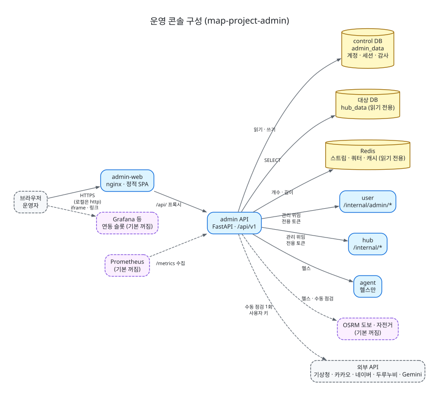
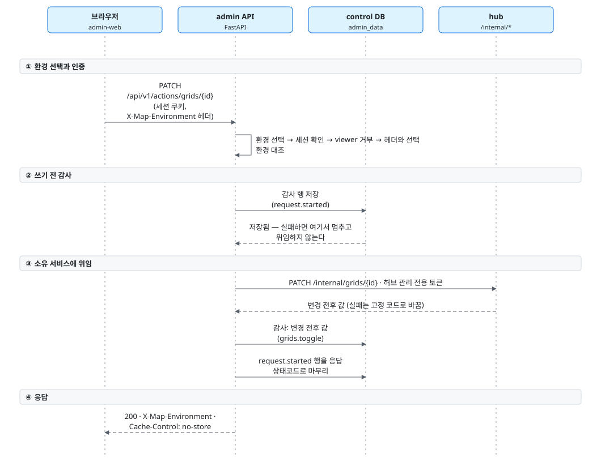

# map-project-admin

MAP 운영 콘솔 — 운영자가 서비스 상태를 보고, 허브 자료를 읽고, 회원·추천 작업·신고를 다루는 FastAPI JSON API 와 React 관리 화면.

## 저장소 지도

MAP 는 일곱 저장소로 이루어져 있다. 전체 구조와 한 번에 실행하는 방법은 [map-project-infra](https://github.com/we-meet-trip/map-project-infra) 에서 시작한다.

| 저장소 | 역할 |
|---|---|
| [map-project-infra](https://github.com/we-meet-trip/map-project-infra) | 전체 안내, 로컬 실행 구성(Docker Compose), DB 초기화 |
| [map-project-client](https://github.com/we-meet-trip/map-project-client) | 모바일 앱(Flutter, iOS·Android) |
| [map-project-user](https://github.com/we-meet-trip/map-project-user) | 사용자 BFF(Spring Boot): 인증·일정·채팅·동의, 다른 서비스 중계 |
| [map-project-agent](https://github.com/we-meet-trip/map-project-agent) | 추천 에이전트(FastAPI·LangGraph): 장소·경로·일정 생성 |
| [map-project-hub](https://github.com/we-meet-trip/map-project-hub) | 외부 데이터 게이트웨이(FastAPI·PostGIS): 관광·날씨·장소·경로 |
| [map-project-yolo](https://github.com/we-meet-trip/map-project-yolo) | 비전 서비스(WebSocket, 객체 탐지 + LLM 식별) |
| **[map-project-admin](https://github.com/we-meet-trip/map-project-admin)** | **운영 콘솔(FastAPI·React)** |

## 이름의 뜻
- `map-project-admin`: MAP 프로젝트의 관리(admin) 저장소. 파이썬 패키지는 `map_project_admin`, 웹 화면 패키지는 `map-project-admin-web` 이다.
- 환경변수 접두 `ADMIN_` 은 admin 만 읽는 값, `MAP_PROJECT_` 는 다른 서비스와 같은 값을 함께 읽는 값이다.

## 개요
운영 콘솔은 직접 데이터를 많이 갖지 않는다. 계정·세션·감사 기록만 스스로 소유하고, 나머지는 소유 서비스에 맡긴다.

- 허브 자료(`hub_data`)는 **읽기 전용**으로 조회한다.
- 쓰기와 회원 원문은 user·hub 의 **내부 API 에 위임**한다. 관리 호출에는 서비스별 **전용 토큰**을 쓴다.
- 모든 쓰기는 실행 **전에 감사 기록**을 남기고, 기록이 안 되면 실행하지 않는다.
- 외부 API 상태 점검은 **사람이 버튼을 누를 때만**, 사용하는 사람의 키로 1회 호출한다.

## 아키텍처

<picture>
  <source media="(prefers-color-scheme: dark)" srcset="docs/diagrams/console-architecture-dark.svg">
  
</picture>

쓰기 요청 하나는 환경 선택 → 인증 → 쓰기 전 감사 → 위임 → 감사 마무리 순서로 처리된다.

<picture>
  <source media="(prefers-color-scheme: dark)" srcset="docs/diagrams/write-request-dark.svg">
  
</picture>

자세한 처리 순서·실행 모드·타임아웃은 [docs/architecture.md](docs/architecture.md), 그림의 근거는 [docs/diagrams/CLAIMS.md](docs/diagrams/CLAIMS.md) 에 있다.

## 기능
| 화면 | 하는 일 |
|---|---|
| 개요 | 서비스·인프라·라우팅 헬스, 기상청 폴링, 장소 집계, Gemini 일일 사용량, 추천 작업 스트림 |
| 외부 API | 여섯 제공자의 설정 여부·마스킹한 키·캐시 키 수, 수동 연결 점검(감사 기록) |
| 날씨·장소 | 폴링 격자 켜고 끄기, 기상청 강제 갱신, 금지구역 추가·삭제(허브 위임) |
| 회원 | 목록(마스킹)·원문 상세(viewer 불가, 열람 감사) — user 위임 |
| 작업 | 추천 작업 통계·목록, 실패 큐 재처리·폐기 — user 위임 |
| DB | `hub_data` 테이블 목록·스키마·행 보기(정렬·검색·필터), CSV 내보내기 |
| 감사 | 감사 기록 조회(행위자·동작·기간 필터) |
| 신고 관리 | 신고 목록·원문 검토, 숨김·채팅 제한(owner) — user 위임 |
| 운영자 | 계정 추가·역할(owner·operator·viewer)·허용 환경 변경(owner) |
| 모니터링 | 설정한 Grafana·Prometheus 등을 iframe·링크로 연결 |

## 빠른 시작
외부 API 키나 비용 없이, 시험용 PostgreSQL 하나로 로그인까지 띄운다. 다른 서비스(user·hub·agent)가 없으므로 헬스는 '도달 불가', 외부 API 는 '미설정', 데이터 화면은 비어 있게 보인다. 전체 서비스와 함께 띄우려면 [map-project-infra](https://github.com/we-meet-trip/map-project-infra) 를 따른다.

준비물: Python 3.10 이상, Node.js 22, Docker.

```bash
# 1) 내려받고 파이썬 의존성 설치
git clone https://github.com/we-meet-trip/map-project-admin.git
cd map-project-admin
python3 -m venv .venv && . .venv/bin/activate
pip install -r requirements.txt

# 2) 시험용 PostgreSQL(컨테이너를 멈추면 데이터도 사라진다) + admin_data 스키마
export PGPW="$(openssl rand -hex 16)"
docker run --rm -d --name map-admin-db --tmpfs /var/lib/postgresql/data \
  -e POSTGRES_PASSWORD="$PGPW" -p 127.0.0.1:55432:5432 postgis/postgis:17-3.5
sleep 5   # 준비될 때까지 기다린다
docker exec map-admin-db psql -U postgres -c "CREATE SCHEMA admin_data"

# 3) 설정: 예시를 복사하고 두 값을 채운다
cp .env.example .env
#   ADMIN_DATABASE_URL=postgresql+psycopg://postgres:<위 PGPW 값>@127.0.0.1:55432/postgres
#   ADMIN_BOOTSTRAP_PASSWORD=<12자 이상 아무 값>   (최초 owner 계정 admin 의 비밀번호)

# 4) 마이그레이션(Alembic 은 .env 를 직접 읽지 않으므로 먼저 내보낸다) → API 기동
set -a; . ./.env; set +a
alembic upgrade head
uvicorn map_project_admin.main:app --host 127.0.0.1 --port 8002

# 5) 다른 터미널에서 화면
cd web && npm ci && npm run dev
#   http://localhost:5173 에서 admin / ADMIN_BOOTSTRAP_PASSWORD 로 로그인
```

- 개발 서버는 `/api` 를 `127.0.0.1:8002` 로 넘기는 프록시라 브라우저 입장에서 같은 출처다. 그래서 CORS 설정은 필요 없다.
- `.env.example` 의 `ADMIN_SESSION_COOKIE_SECURE=false` 는 http 로컬 실행용이다. **HTTPS 로 외부에 열기 전에는 반드시 `true` 로 바꾼다**(코드 기본값은 `true`).
- 끝낼 때: `docker stop map-admin-db`.

## 설정
모든 키와 설명은 [.env.example](.env.example) 에 있다. 자주 바꾸는 것:

| 키 | 뜻 |
|---|---|
| `ADMIN_DATABASE_URL` | 단일 호스트 모드에서 control 과 기본 대상이 함께 쓰는 DSN |
| `ADMIN_BOOTSTRAP_USER`·`ADMIN_BOOTSTRAP_PASSWORD` | 계정이 하나도 없을 때만 만드는 최초 owner |
| `ADMIN_SESSION_COOKIE_SECURE` | 세션 쿠키 HTTPS 전용 여부(기본 `true`) |
| `ADMIN_USER_BASE_URL`·`MAP_PROJECT_HUB_BASE_URL`·`MAP_PROJECT_AGENT_BASE_URL` | 위임·헬스 대상 주소 |
| `MAP_PROJECT_USER_ADMIN_INTERNAL_TOKEN`·`MAP_PROJECT_HUB_ADMIN_INTERNAL_TOKEN` | 관리 전용 토큰(비었거나 일반 토큰과 같으면 관리 호출을 보내지 않는다) |
| `ADMIN_CONTROL_DATABASE_URL`·`ADMIN_TARGETS` | 중앙 모드(전용 control DB, 여러 환경) — [docs/architecture.md](docs/architecture.md) "실행 모드" |

목록·사전형 값(`ADMIN_CORS_ORIGINS`·`ADMIN_TARGETS`·`ADMIN_MONITORING_PANELS`)은 JSON 으로만 쓴다. 빈 값(`KEY=`)은 기동 오류다.

## 데이터
이 저장소는 데이터셋을 담지 않는다. admin 이 소유한 테이블과 감사 기록에 남기는 것·남기지 않는 것은 [docs/data.md](docs/data.md) 에 있다.

## API 와 계약
브라우저용 API(`/api/v1`)의 역할별 권한, user·hub 위임 경로와 자격, 오류 변환 규칙, 읽기만 하는 Redis 키는 [docs/contracts.md](docs/contracts.md) 에 있다. 로그인한 상태에서 `/docs` 로 Swagger 를 볼 수 있다.

## 폴더 구조
```
map_project_admin/    FastAPI 앱 — main·config·security·accounts·audit·db·repo·upstream 등
  routers/            /api/v1 경로별 라우터
migrations/           Alembic 환경과 revision(admin_data 스키마)
scripts/              control DB 준비 SQL, 격리 통합 점검, 그림 렌더(render_diagrams.sh, seq.py)
tests/                pytest 시험, 브라우저 점검(browser-moderation.cjs)
web/                  React 관리 화면(Vite → nginx) — web/README.md
docs/                 구조·데이터·계약·트러블슈팅·설계 결정·그림
```

## 테스트
```bash
pip install -r requirements.txt -r requirements-dev.txt
pytest -q                                  # 외부 네트워크·DB 없이 돈다
(cd web && npm ci && npm run build)        # 타입 검사 + 빌드
```
- 공개 전에 확인한 결과: `pytest -q` 91 통과·1 건너뜀(Python 3.10~3.14 동일), 웹 빌드 통과.
- 건너뛰는 1개는 격리된 PostgreSQL 이 필요한 시험이다: `ADMIN_TEST_DATABASE_URL` 에 새로 마이그레이션한 DB(owner 계정 1개 포함)를 주면 돈다. 공유 서버에는 돌리지 않는다.
- 격리 통합 점검: `python scripts/verify-control-isolation.py` — Docker 로 새 tmpfs PostgreSQL 을 띄워 control DB 역할 분리와 대상 장애 시 로그인 유지를 12개 항목으로 확인하고 지운다(`postgis/postgis:17-3.5` 이미지가 미리 있어야 한다). CI 에서는 `integration.yml` 이 돌린다.
- 브라우저 점검: `node tests/browser-moderation.cjs` — `web/dist` 빌드와 `playwright-core` 가 필요한 수동 점검이다. 합성 HTTP 응답으로 신고 화면의 원문 이스케이프·역할별 버튼·재시도 UUID 를 본다. `ADMIN_TEST_BROWSER`(브라우저 실행 파일), `ADMIN_TEST_SCREENSHOT`(스크린샷 경로)을 줄 수 있다.

## 트러블슈팅과 교훈
겪은 문제 14건은 [docs/troubleshooting.md](docs/troubleshooting.md) 에, 그 결과로 내린 설계 결정은 [docs/decisions/](docs/decisions/) 에 있다. 되풀이된 교훈:
- 관리 도구의 상태 저장소는 관리 대상과 다른 장애 영역에 둔다(대상이 죽어도 로그인된다).
- 같은 비밀을 여러 용도로 쓰지 않는다(관리 호출은 전용 토큰).
- 경계 밖으로는 내가 만든 문구만 보낸다(예외 문장·업스트림 본문을 그대로 넘기지 않는다).
- "설정하지 않음" 은 장애가 아니다 — 상태 값은 참·거짓·미구성 셋이다.

## 한계
- 교육·학습용 공개본이다. 지원·보안 수정 기한을 약속하지 않는다.
- 단독 실행으로는 데이터 화면이 비어 있다. 실제 화면을 보려면 다른 서비스와 함께 띄운다.
- DB 뷰어는 대상 DB 의 읽기 전용 계정이 있어야 한다. 대상마다 DSN 을 주지 않으면 그 대상의 SQL 화면은 503 이다.
- 감사 기록의 보존 기간·자동 삭제는 없다. 보존 정책은 운영하는 사람이 정한다.
- 최초 계정 비밀번호는 비었는지만 검사한다(운영자 API 는 12자 이상을 요구한다).
- 차트 라이브러리(Recharts 2.x)는 지원이 끝나 가는 판이다.
- 브라우저 점검은 CI 에서 돌지 않는다.

## 감사 표시
- 데이터셋: 쓰지 않는다.
- 글꼴: 저장소에 글꼴 파일을 넣지 않는다. 화면은 사용자 시스템에 설치된 글꼴 이름만 지정한다. 그림은 [Pretendard](https://github.com/orioncactus/pretendard)(SIL Open Font License 1.1)로 렌더했다.
- 아이콘: 외부 아이콘 라이브러리를 쓰지 않는다(화면의 아이콘은 저장소 안 인라인 SVG).
- 외부 API: 기상청 단기예보, 카카오 로컬, 네이버 검색, 한국관광공사 두루누비, OSRM, Google Gemini — 상태 점검에서만 부르며, 사용하는 사람이 각 제공자 약관에 따라 발급한 키를 쓴다.

## 고지

- 이 저장소는 교육·학습 목적으로 공개한 코드다. 운영 중인 서비스가 아니며 지원을 약속하지 않는다.
- 이 프로젝트는 코드가 연동하는 외부 서비스·데이터 제공자(한국관광공사, 기상청, 공공데이터포털, 국토교통부, 서울특별시, 한국환경공단, 카카오, 네이버, Google, Apple, LangChain, ODsay, OpenStreetMap, Ultralytics, Wikimedia 등)와 관련이 없으며, 그들로부터 승인이나 후원을 받지 않았다. 언급한 상표와 서비스 이름은 각 소유자에게 있다.
- 저장소에는 제3자 데이터·이미지·본문을 넣지 않는다. 예외로, 이용조건을 원문으로 확인한 공공·개방 자료만 출처와 이용조건을 밝혀 담는다(`docs/data.md`). 그 밖의 외부 데이터는 각 제공자의 약관에 따라 직접 받아야 한다.
- MIT 라이선스는 이 저장소의 코드에만 적용된다. 저장소에 담은 공공·개방 자료와 외부 데이터, 모델 가중치, 폰트, 라이브러리는 각자의 이용조건·라이선스를 따른다.

## 라이선스

코드는 [MIT 라이선스](LICENSE)를 따른다. Copyright (c) The MAP Contributors. 만든 사람들은 [AUTHORS.md](AUTHORS.md) 에 있다.
